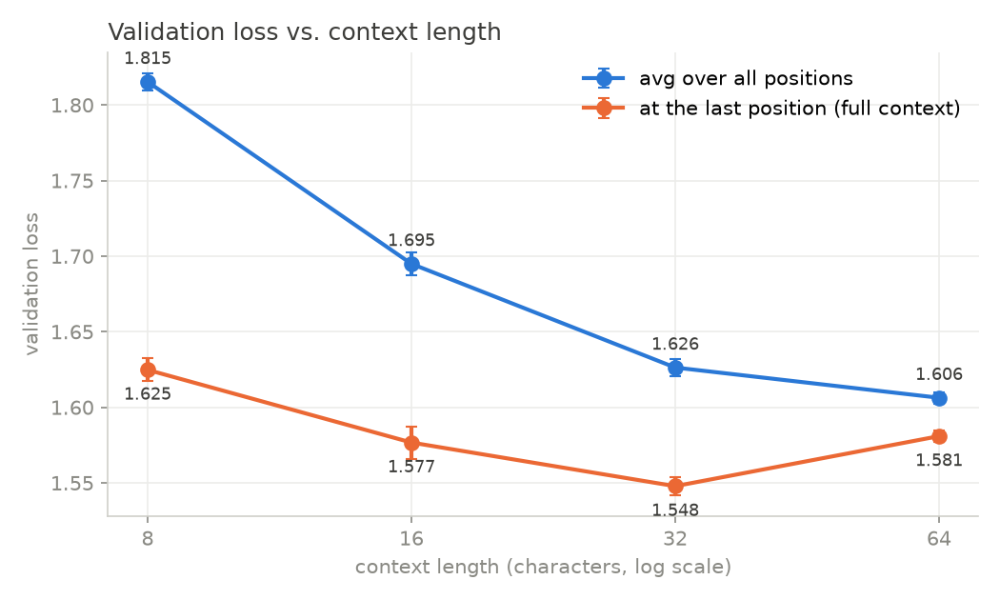
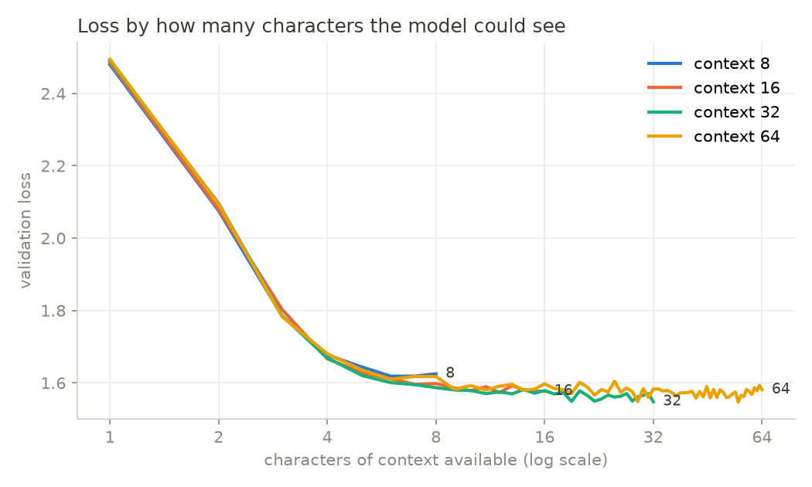

# char-transformer

A small character-level transformer language model, written in PyTorch largely from scratch and trained on Tiny Shakespeare (about 1.1M characters). The project builds up in stages, each one fixing a weakness of the one before:

| Stage | Model | What it adds | File |
|---|---|---|---|
| 1 | Counting bigram | Baseline: P(next char \| current char) from counts | `src/bigram_count.py` |
| 2 | Neural bigram | The same table, but learned with gradient descent | `src/model.py` (`BigramLanguageModel`), `src/bigram_neural.py` |
| 3 | Self-attention | Looks back over all previous characters, with a causal mask | `src/model.py` (`Head`, `MultiHeadAttention`) |
| 4 | Transformer | Feed-forward layers, residual connections, LayerNorm, stacked blocks | `src/model.py` (`Block`, `GPT`) |
| 5 | Training | AdamW, warmup and cosine LR schedule, gradient clipping | `src/training.py`, `src/train.py` |
| 6 | Experiment | How much does longer context help? | `src/experiment.py` |

Everything is scored by **validation loss**: the average cross-entropy (negative log-likelihood) of the true next character on held-out text. Lower is better. For reference, guessing uniformly over 65 characters scores ln(65) ≈ 4.17.

## Results

<!-- Fill in from results/ after running on Colab -->

| Model | Val loss |
|---|---:|
| Uniform guess | 4.17 |
| Counting bigram | 2.48 |
| Neural bigram | ~2.50 |
| Transformer (context 64, 4 layers, ~0.8M params) | _TODO_ |

Sample from the transformer: see `results/transformer/sample.txt`.

## Experiment: does more context help?

**Question:** how much does seeing more previous text improve next-character prediction?

**Setup:** the same 4-layer, 128-dim transformer trained with context lengths 8, 16, 32 and 64. Held fixed across runs:

- **Characters trained on.** A batch of B sequences of length T has B×T targets. With a fixed batch size, the context-64 model would see 8× more training signal per step than context-8, so the comparison would mix up "more context" with "more data". The batch size is set to `4096 / context` so every run trains on 4096 targets per step.
- Steps, learning-rate schedule, model size (only the position-embedding table grows with context), and the validation windows used for scoring.
- Three random seeds per setting, reported as mean ± std.

**Two metrics:**
- *Val loss (all positions):* the usual average over every position in the window. Position 0 has only one character of context even in a 64-context model, so this average understates long-context models.
- *Val loss (last position):* the loss only where the model has its full context. This is the cleanest measure of what N characters of context buys.

<!-- Paste results/context_experiment/results.md here -->

_TODO: table_




**Findings:** _TODO: 3-4 sentences. Where do the gains come from, and where do they flatten out? Does the per-position plot show models matching each other at equal positions? Did the gap between train and val loss change?_

## Architecture

```
token ids (B, T)
  -> token embedding (V -> 128) + position embedding (T -> 128)
  -> 4 x Block:
        x = x + MultiHeadAttention(LayerNorm(x))   # 4 heads of 32 dims, causal mask
        x = x + FeedForward(LayerNorm(x))          # 128 -> 512 -> 128, GELU
  -> LayerNorm -> Linear (128 -> V)
  -> logits for the next character at every position (B, T, V)
```

Design choices: pre-norm blocks (as in GPT-2), weights initialised with std 0.02 so the starting loss is about ln(V), dropout 0.1, AdamW with weight decay 0.1, linear warmup then cosine decay, and gradient-norm clipping at 1.0.

`tests/test_model.py` checks the parts most likely to be silently wrong: that changing a future character does not change earlier predictions (the causal mask), that attention rows sum to 1, that the initial loss is about ln(V), and that the model can memorise a single batch.

## Running it

On Colab: open `notebooks/colab.ipynb`, choose a T4 GPU runtime, and run the cells top to bottom.

Locally:

```bash
pip install -r requirements.txt
python -m pytest -q
python -m src.bigram_count
python -m src.bigram_neural
python -m src.train
python -m src.experiment --seeds 1 2 3
```

`python -m src.experiment --quick` runs a tiny version on CPU in about a minute to check that everything works.

## Limitations

- **Tiny scale.** About 0.8M parameters and 1M characters of training data. The output looks like Shakespeare at a glance but is mostly not real words or grammar.
- **Characters, not subwords.** Real LLMs use subword tokenizers (BPE), so one token covers several characters and the same context length reaches much further back.
- **One dataset, one model size.** The context-length result may not hold for larger models or other text. Larger models may make better use of long context.
- **Fixed training budget.** Every run gets the same number of steps. Longer-context models might need more training to show their full benefit.
- **Attention is O(T²)** in memory and compute, which is why context length is expensive to scale.

## Acknowledgements

The staged approach follows Andrej Karpathy's "Let's build GPT" lecture and nanoGPT. This project adds the token-matched context-length experiment, the per-position loss analysis, attention visualisations and the sanity tests.
